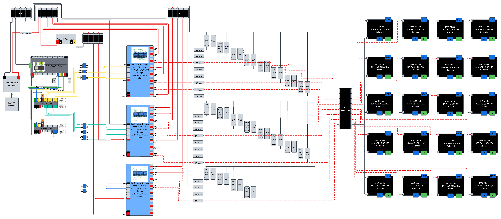

# CPD Range Target Control

Members: Vidhula Oviya Vasanthan, Luke Sapp, Joey Borrelli, Isaac Brown, Connor Smith

Project Description:
A web-based control and qualification-tracking system for the Cookeville Police Department's range.

## Control Targets

- Raise or hide individual targets, or control groups using **All**, **Odd**, **Even**, and **Random**.
- Turn on **Manual Mode** before using the target controls.
- Choose which targets to use when starting a drill: all, odd, even, or individual targets.
- Filter the target display by number or range, hide unavailable targets, and switch between grid and list views.
- Mark a target unavailable in **Settings**. It is shown as defective and excluded from drills and manual commands.

## Run and Manage Drills

- Browse drills by type **Full Drills**, **Custom**, and **Stages** and filter by qualification.
- Create and edit drills with a sequence builder. Add **Present**, **Hide**, **Delay**, **Pause**, and **Run Drill** steps.
- Configure steps for all selected targets, specific targets, or a random number of targets.
- Combine saved drills into larger drills. Rename drills and remove drills that are no longer in use.
- Start, pause, and resume a drill. Redo a paused stage without restarting the entire drill.
- See the current drill, stage, target positions, and remaining delay time.
- Set an instant, fixed, or random countdown before a drill starts or resumes. Cancel the countdown before it sends a command.

## Record Qualification Results

- Add officers and custom qualification types.
- Enter one or several dated scores for an officer.
- Search results by officer name or badge number; filter by qualification, score, and date; and sort by score or date.
- Review officer averages, top scores, and attempt counts for the last 12 months.
- Export selected qualification results as a PDF.

## Settings and Connection

- Change the **CPD Range Control** Wi-Fi password. Phones must reconnect after a password change.
- Set a drill-start countdown separately on each phone.
- Drills, target availability, officers, qualifications, and scores are saved on the controller and shared across connected phones.
- The web interface and supporting assets are stored on the controller for use without an internet connection.
- View controller connection quality and hardware availability.

## Hardware

An ESP32-S3 drives two MCP23S17 SPI I/O expanders, which switch three SainSmart 8-channel relay boards. Each relay powers one target's MAC 12 V pneumatic valve through a 3 A fuse and a diode/MOV surge clamp, over the range's original buried field cable. A powered valve turns its target to face the shooter; losing power hides every target.

- **Power:** Tripp Lite PR-40 (13.8 V) through a 7 A slow-blow fuse feeds the relay contacts and valves. A Pololu 5 V converter, fused at 3 A, powers the relay boards and the ESP32. The expanders run from the ESP32's 3.3 V pin.
- **Expander to relay map** (from [`include/pins.h`](include/pins.h), which is authoritative): MCP23S17 #1 GPB7–GPB0 → relay board #2 → targets 1–8; MCP23S17 #1 GPA7–GPA0 → relay board #1 → targets 9–16; MCP23S17 #2 GPA7–GPA4 → relay board #3 IN1–IN4 → targets 17–20. The diagram labels relay boards #1 and #2 the other way round.
- **SPI:** SCK GPIO 12, SI (MOSI) GPIO 11, SO (MISO) GPIO 13, CS GPIO 14 (expander #1) and GPIO 10 (expander #2), with 10 kΩ pull-ups on both CS lines.

Full wiring diagram ([PDF](docs/architecture/CPD_Range_Diagram_Final.pdf)):

